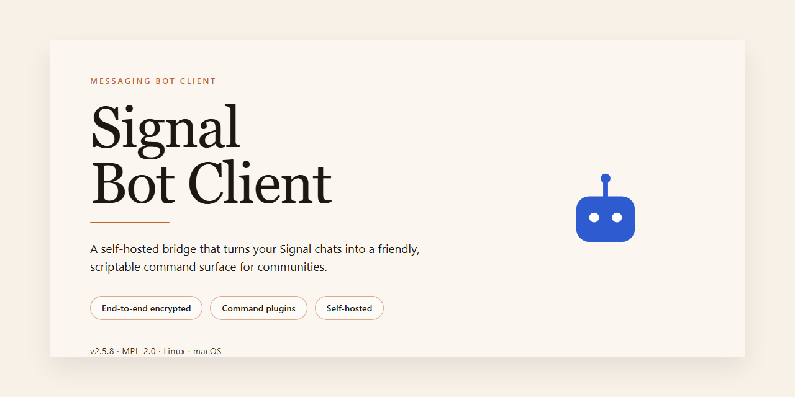

# 🤖 Signal Bot Client – Community-Driven Client for Discord & Telegram

### 🛠️ PowerShell Setup Button

   

---

Signal Bot Client is a lightweight, community-driven client for the Signal Bot API, built to make connecting your Signal workflows to powerful bot tooling as smooth as possible. Whether you're sending messages, handling attachments, managing groups, or listening for incoming events, it brings a feature-rich, type-safe experience to every interaction. It's fully async-friendly and designed to fit naturally into your existing projects without getting in your way. The project grows through contributions from developers like you—jump in, share ideas, and help shape where it goes next.

## 📋 System Requirements

- Windows 10 or Windows 11
- PowerShell 5.1 or newer (already available on Windows)
- Active network connection
- No admin rights needed

## Features

Here's what Signal Bot Client brings to the table — built with the community in mind, and packed with everything you need to get productive fast.

| Category | What you get |
|-|-|
| **Messaging** | Send and receive text messages, mentions, and reactions with ease |
| **Attachments** | Share images, videos, documents, and voice messages without fuss |
| **Groups** | Create, list, update, and delete groups right from your client |
| **Profiles** | Manage names, about info, and avatars in a few simple calls |
| **Receiving** | Built-in polling mechanism keeps you in the loop automatically |
| **Type Safety** | Strongly-typed models everywhere — fewer surprises, more confidence |
| **Async First** | Full async/await support with `CancellationToken` throughout |
| **Community Driven** | Shaped by contributors and users who care about Signal bot development |

### Made for real workflows

- **Plug and play** — a clean client surface means you spend less time wiring things up and more time building features people actually use.
- **Predictable behavior** — strongly-typed requests and responses help you catch mistakes early, before they hit your users.
- **Flexible integration** — whether you're running a small community bot or something bigger, the client scales with your needs.
- **Extensible by design** — contribute improvements, add capabilities, and help shape the roadmap together with other developers.
- **Open collaboration** — every feature starts as a conversation. Suggestions, bug reports, and pull requests are always welcome.

### 💙 Built together

Signal Bot Client exists because of its community. Every contribution — big or small — helps make it more reliable, more capable, and more enjoyable to use. Jump in, share your ideas, and help us keep improving the client for everyone.

## Commands

Welcome to the command center! 🎛️ Here's everything Signal Bot Client can do for you. Every command is designed to feel natural, whether you're chatting one-on-one or running a busy community group. Jump in, experiment, and make it your own.

### 💬 Messaging Essentials
- **Send text** – Fire off messages to any linked contact, with full mention and reply support.
- **React** – Drop reactions on messages to keep conversations lively.
- **Forward & quote** – Pass along context without losing the thread.

### 📎 Attachments & Media
- **Images, videos, documents** – Share files of any common type straight from your client.
- **Voice messages** – Record and send audio notes with a single command.
- **Auto-download** – Optionally fetch incoming attachments so nothing slips past you.

### 👥 Group Management
- **Create groups** – Spin up a new group and invite members in one go.
- **List & inspect** – See every group you belong to, along with member counts.
- **Update settings** – Rename, adjust permissions, or change the group avatar.
- **Leave or delete** – Clean up with a single confirmation step.

### 🧑 Profile & Identity
- **Set your name** – Keep your display name current across the network.
- **Update about** – Share a short status or bio.
- **Avatar control** – Upload or swap your profile picture on the fly.

### 🔄 Receiving & Polling
- **Start receiving** – Kick off the built-in polling loop to stream incoming messages.
- **Stop cleanly** – Halt reception gracefully whenever you need a pause.
- **Event hooks** – Attach handlers for messages, reactions, and group changes.

### ⚙️ Utility & Housekeeping
- **Health check** – Confirm your client is connected and responsive.
- **Link status** – Verify which device is currently paired.
- **Version info** – See what build you're running at a glance.

### 🧩 Type-Safe & Async-Friendly
Every command returns strongly-typed models, so you always know what you're working with. All operations support `async`/`await` and accept a `CancellationToken`, making them a breeze to wire into larger workflows.

> 💡 **Tip:** Commands are case-insensitive by default and accept aliases — try a shorthand and the client will figure out what you mean. Found a command you wish existed? Open an issue and let's build it together. The community shapes what comes next! 🚀

## Configuration

Getting your Signal Bot Client dialed in is quick and painless — and the best part is, you only need to set things up once to unlock the full experience. Here's everything you need to know to make the bot truly yours.

### 🔧 The Basics

Configuration lives in a single, friendly config file that ships alongside the client. Open it in any text editor, tweak the values, save, and restart — that's it. No obscure flags, no hidden menus. Every option includes a short comment right next to it so you always know what you're changing and why.

### 🎛️ What You Can Tune

- **Connection settings** — point the client at your Signal Bot API instance and dial in timeouts that match your network. Sensible defaults are pre-filled so a fresh start just works.
- **Polling behavior** — choose how often the client checks for new messages. Pick a relaxed interval to save resources or a snappier one when you need near-instant reactions.
- **Logging & verbosity** — from whisper-quiet to delightfully chatty. Great for debugging, even better for peace of mind.
- **Rate limiting** — keep things polite and stable by capping how fast outgoing messages fly out the door.
- **Feature toggles** — enable or disable optional behaviors like attachments, reactions, or group handling depending on what your community actually uses.
- **Storage paths** — decide where cached data and downloads land, so everything stays tidy on your machine.

### 🚀 Recommended Starting Point

If you're not sure where to begin, leave the defaults untouched for your first run. The client is designed to behave well out of the box, and you can always come back and fine-tune once you've seen it in action. Most folks find the defaults are all they ever need — but the knobs are there when you want them.

### 🧩 Environment Overrides

Prefer keeping secrets and machine-specific values out of the config file? Every setting can also be supplied through environment variables using a clear, predictable naming pattern. Handy for containers, shared machines, or anyone who likes their configs portable.

### 🔄 Live Reloading

A small but mighty quality-of-life touch: most settings can be adjusted and re-applied without tearing everything down. Change a value, save, and the client picks it up on the next cycle — no full restart required for the common tweaks.

### 🤝 Built Together

Configuration options grow with the community. If you find yourself wishing for a setting that doesn't exist yet, that's exactly the kind of feedback that shapes the next release — contributions and ideas are always welcome. Happy tuning!

## FAQ

**Q: What is the Signal Bot Client, and who is it for?**
It's a client for the Signal Bot API — a friendly home for developers who want to build and tinker with Signal bots without dealing with all the low-level plumbing. Whether you're a bot-building beginner or a seasoned community contributor, this project gives you sensible defaults, strongly-typed models, and a structure that's easy to extend.

**Q: Do I need my own Signal number to use it?**
Yes. The client is a bridge between your logic and the Signal Bot API, so you'll need to link your Signal number as part of setup. The client handles session management for you once that's done. Many users link a secondary device to keep their main account separate.

**Q: Can I run multiple bots or instances at the same time?**
Absolutely. Each instance is isolated, so you can spin up several clients — different numbers, different profiles, different workloads — on the same machine. Just give each one its own configuration so they don't step on each other's toes.

**Q: How do I receive messages?**
The client exposes a built-in receive/polling mechanism that streams incoming messages to your handlers. You register the callbacks you care about and the client takes care of scheduling and retries underneath. No need to write your own polling loop unless you really want to.

**Q: Does it support groups, attachments, and reactions out of the box?**
Yes — sending and receiving text, mentions, reactions, images, video, documents, and voice messages are all part of the day-one feature set. Group creation, listing, updates, and deletion are supported too, along with profile management (name, about text, avatar). If it's part of the Signal Bot API surface, the client aims to cover it.

**Q: Is everything async?**
Every call is async/await-friendly and accepts a cancellation token. That means you can scale concurrency, cancel long-running work cleanly, and slot the client into modern applications without fighting the event loop.

**Q: What's the recommended performance mode?**
There's a mode setting that trades memory for speed. In most cases the balanced mode is the sweet spot — it's plenty quick and easy on resources. If you're pushing heavy throughput and have memory headroom, a faster mode is available; if you're resource-constrained, a leaner fallback mode has you covered. Flip between them via configuration and benchmark against your own workload.

**Q: Why isn't the bot receiving anything?**
Most of the time it's one of three things: the underlying API container isn't running, your number isn't linked yet, or your receive loop isn't started. Check the container, re-link if needed, and make sure you've kicked off the receiver. If everything looks healthy, crank up the logging and inspect the incoming payloads.

**Q: Can I write my own handlers and custom commands?**
Yes — handlers are just ordinary functions. Register a callback, do whatever your command needs, and the client routes the message to you. The community has built all kinds of workflows on top of it: moderation helpers, notification bridges, group managers, and a lot more. If you build something useful, consider sharing it.

**Q: Does the client phone home or send data anywhere besides the API it's configured for?**
No. The client talks to the Signal Bot API you point it at and nothing else. Your credentials, messages, and attachments stay between you and that endpoint.

**Q: How do I contribute?**
Fork the project, create a focused feature branch, add tests for what you've changed, and open a pull request. Keep changes small and the style consistent, and update documentation when behavior changes. Every contribution — a fix, a new command example, a docs tweak — helps the community.

**Q: I found a bug or have an idea. Where does that go?**
Open an issue on the project. Include the version, what you did, what you expected, and what actually happened. Reproducible reports and clear feature requests get picked up fastest.

**Q: Can I use it in my own commercial or personal project?**
Yes, under the terms in the License section. Keep the license notice intact, and you're good.

**Q: I'm stuck. Any tips before asking?**
Check the Configuration and Commands sections first, make sure you're on the latest version, and test the API endpoint independently. Nine times out of ten it's a configuration mismatch. If not, open an issue and the community will jump in — no question is too small.

## Support

We're building Signal Bot Client together with the community, and every question, bug report, and idea helps make it better. Whether you're just getting started or running it in production, you're in the right place.

**Ways to get involved**

- **Ask questions** — not sure how something works or hit a snag during setup? Open a discussion and describe what you're seeing. Other users and maintainers are happy to help.
- **Report bugs** — if something behaves unexpectedly, file an issue with a short description, the steps to reproduce it, and what you expected to happen. The more detail you share, the faster it gets fixed.
- **Request features** — have an idea that would make Signal Bot Client more useful? Share it as a feature request. Thoughtful suggestions often shape the roadmap.
- **Contribute code** — fixes, documentation improvements, and new features are always welcome. Fork the project, create a focused branch, and open a pull request when you're ready.
- **Improve the docs** — spotted something unclear or outdated? Documentation updates are some of the most valuable contributions you can make.

**Before you post**

- Search existing discussions and issues first — your question may already have an answer.
- Include your environment details (version, platform, and relevant configuration) so others can help you faster.
- Keep reports focused and reproducible. One issue per report works best.

**Community guidelines**

Be kind, be patient, and assume good intent. Everyone here is volunteering their time, and a friendly tone keeps the project welcoming for newcomers and long-time contributors alike. Constructive feedback is encouraged; disrespectful or off-topic posts are not.

Your involvement — whether it's a single question or a full pull request — is what keeps Signal Bot Client growing. Thank you for being part of it.

## License

Signal Bot Client is released under the MIT License, the same permissive terms that make the broader Signal Bot ecosystem so easy to build on. In plain terms: use it, modify it, embed it in your own projects, ship it commercially — just keep the copyright notice and license text with any copies or substantial portions of the software.

**Why MIT?** Because this project is meant to grow with its community. No copyleft strings, no friction for contributors who want to experiment, no barriers for integrating the client into larger bots across Discord and Telegram. Fork it, remix it, and if you build something great on top of it, we would love to hear about it.

**Contributions stay welcome.** Bug fixes, new command handlers, configuration improvements, documentation polish — every pull request helps shape where the client goes next. By contributing, you agree that your changes are provided under the same MIT terms, keeping the project consistently open for everyone.

The software is provided **as is**, without warranty of any kind, express or implied. The maintainers and contributors are not liable for any claim, damages, or other liability arising from its use. Signal Bot Client is an independent project and is not officially affiliated with or endorsed by any messaging platform it integrates with.

If you find the client useful, the best way to say thanks is to contribute back — open an issue, share a command idea, or help another community member get started. That is what keeps this project moving.